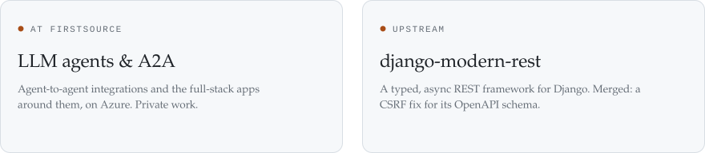
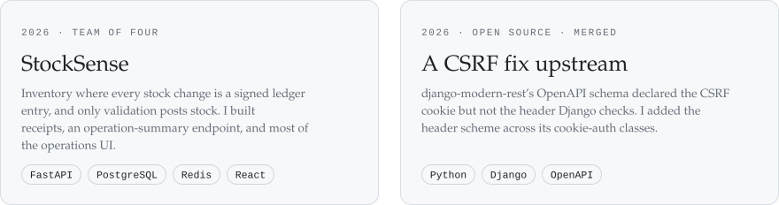
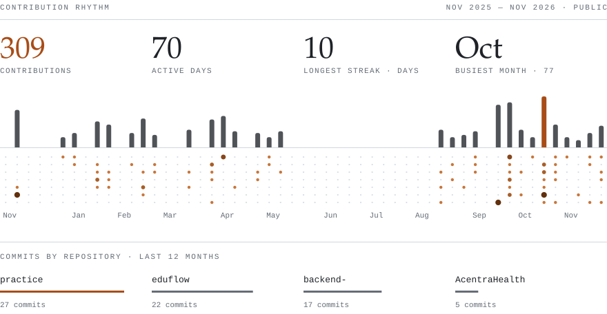
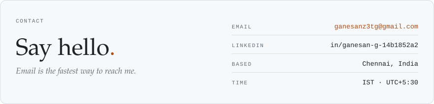

<!-- Generated by scripts/build-static.mjs from scripts/content.mjs. Edit those, not this file. -->

<picture>
  <source media="(prefers-color-scheme: dark)" srcset="assets/profile/hero-dark.svg">
  <source media="(prefers-color-scheme: light)" srcset="assets/profile/hero-light.svg">
  
</picture>

## 01 — Now

<picture>
  <source media="(prefers-color-scheme: dark)" srcset="assets/profile/now-dark.svg">
  <source media="(prefers-color-scheme: light)" srcset="assets/profile/now-light.svg">
  
</picture>

## 02 — Selected work

<picture>
  <source media="(prefers-color-scheme: dark)" srcset="assets/projects/attendance-dark.svg">
  <source media="(prefers-color-scheme: light)" srcset="assets/projects/attendance-light.svg">
  
</picture>

<a href="https://github.com/ganesan33/AcentraHealth">
<picture>
  <source media="(prefers-color-scheme: dark)" srcset="assets/projects/fraud-agent-dark.svg">
  <source media="(prefers-color-scheme: light)" srcset="assets/projects/fraud-agent-light.svg">
  
</picture>
</a>

<a href="https://github.com/ganesan33/AcentraHealth">Repository ↗</a>

<a href="https://github.com/ganesan33/eduflow">
<picture>
  <source media="(prefers-color-scheme: dark)" srcset="assets/projects/eduflow-dark.svg">
  <source media="(prefers-color-scheme: light)" srcset="assets/projects/eduflow-light.svg">
  
</picture>
</a>

<a href="https://github.com/ganesan33/eduflow">Web ↗</a> &nbsp;·&nbsp; <a href="https://github.com/ganesan33/backend-">API v2 ↗</a> &nbsp;·&nbsp; <a href="https://github.com/ganesan33/Eduflow-Mobile-app">Android ↗</a>

<picture>
  <source media="(prefers-color-scheme: dark)" srcset="assets/projects/also-dark.svg">
  <source media="(prefers-color-scheme: light)" srcset="assets/projects/also-light.svg">
  
</picture>

<a href="https://github.com/wemake-services/django-modern-rest/pull/1718">The merged pull request ↗</a>

## 03 — Path

<picture>
  <source media="(prefers-color-scheme: dark)" srcset="assets/profile/path-dark.svg">
  <source media="(prefers-color-scheme: light)" srcset="assets/profile/path-light.svg">
  
</picture>

## 04 — Rhythm

<picture>
  <source media="(prefers-color-scheme: dark)" srcset="assets/activity/rhythm-dark.svg">
  <source media="(prefers-color-scheme: light)" srcset="assets/activity/rhythm-light.svg">
  
</picture>

Bars are weekly totals; dots are days. Drawn from GitHub's public contribution calendar and REST API by <a href="scripts/build-activity.mjs">scripts/build-activity.mjs</a> and redrawn daily by a workflow.

<!-- rhythm:table -->

The same data as a table

| Month | Contributions | Active days |
|:--|--:|--:|
| Nov 2025 | 0 | 0 |
| Dec 2025 | 29 | 3 |
| Jan 2026 | 27 | 9 |
| Feb 2026 | 23 | 6 |
| Mar 2026 | 19 | 4 |
| Apr 2026 | 30 | 6 |
| May 2026 | 7 | 3 |
| Jun 2026 | 0 | 0 |
| Jul 2026 | 0 | 0 |
| Aug 2026 | 8 | 5 |
| Sep 2026 | 73 | 9 |
| Oct 2026 | 77 | 16 |
| Nov 2026 | 16 | 9 |

| Repository | Commits, last 12 months |
|:--|--:|
| practice | 27 |
| eduflow | 22 |
| backend- | 17 |
| AcentraHealth | 5 |

<!-- /rhythm:table -->

## 05 — Contact

<a href="mailto:ganesanz3tg@gmail.com">
<picture>
  <source media="(prefers-color-scheme: dark)" srcset="assets/profile/contact-dark.svg">
  <source media="(prefers-color-scheme: light)" srcset="assets/profile/contact-light.svg">
  
</picture>
</a>

<a href="mailto:ganesanz3tg@gmail.com">ganesanz3tg@gmail.com ↗</a> &nbsp;·&nbsp; <a href="https://www.linkedin.com/in/ganesan-g-14b1852a2/">LinkedIn ↗</a>

 

Every image on this page is an SVG drawn by the scripts in this repository, from <a href="scripts/content.mjs">one content file</a>. No third-party widgets. <a href="DESIGN.md">How it’s made</a>.
