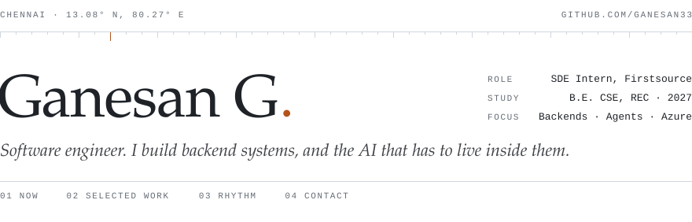
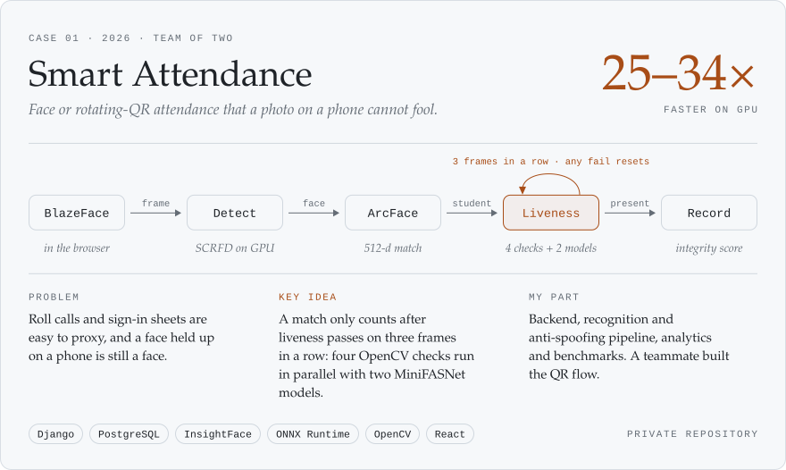
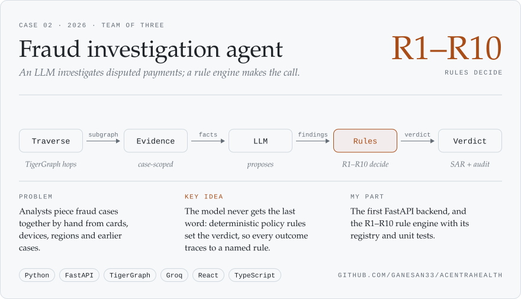
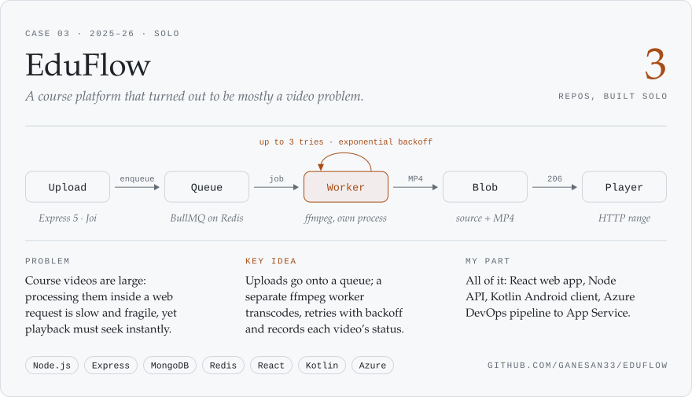

<picture>
  <source media="(prefers-color-scheme: dark)" srcset="assets/profile/masthead-dark.svg">
  <source media="(prefers-color-scheme: light)" srcset="assets/profile/masthead-light.svg">
  
</picture>

 

I like the unglamorous middle of software: queues, auth boundaries, retries, and the deterministic code that keeps a language model honest. I study Computer Science at Rajalakshmi Engineering College (class of 2027) and work as a software development engineer intern at Firstsource, in Chennai.

**Failure should be a state, not a surprise.** Queues, retries, explicit statuses, workers that can safely run twice. 
**Models propose; code decides.** LLMs belong inside systems that can be tested and audited. 
**Own the whole path.** Schema, API, client, container, cloud.

## 01 — Now

**At Firstsource**, building LLM agents, agent-to-agent integrations and the full-stack applications around them, deployed on Azure. That work stays private; everything below is my own. 
**Upstream**, contributing to [django-modern-rest](https://github.com/wemake-services/django-modern-rest), a typed, async REST framework for Django. 
**Lately**, finalist at Smart India Hackathon 2026, after reaching the top 100 in 2025.

## 02 — Selected work

### Smart Attendance

2026 · team of two · Django, PostgreSQL, InsightFace, ONNX Runtime, OpenCV, React · private repository

<picture>
  <source media="(prefers-color-scheme: dark)" srcset="assets/projects/attendance-dark.svg">
  <source media="(prefers-color-scheme: light)" srcset="assets/projects/attendance-light.svg">
  
</picture>

Attendance by face at a classroom kiosk, or by a rotating, HMAC-signed QR code confirmed with the student's college Google account. The hard part is the kiosk, because a photo of a face on a phone is still a face. After a face matches a 512-d ArcFace embedding, it must also pass a liveness check on three consecutive frames: four OpenCV checks (texture, edge density, moiré via FFT, phone borders via Hough lines) run in parallel with two MiniFASNet models, and any failure resets the count. Running detection and recognition on the GPU instead of the CPU cut each frame from about 1.5 s to about 50 ms, 25–34× faster on our test images.

My part: the backend, the recognition and anti-spoofing pipeline, analytics with integrity scores and risk warnings, and the benchmarks. My teammate built the QR flow.

### Fraud investigation agent

2026 · team of three · Python, FastAPI, TigerGraph, Groq, React + TypeScript · [repository](https://github.com/ganesan33/AcentraHealth)

<picture>
  <source media="(prefers-color-scheme: dark)" srcset="assets/projects/fraud-agent-dark.svg">
  <source media="(prefers-color-scheme: light)" srcset="assets/projects/fraud-agent-light.svg">
  
</picture>

An agent walks a TigerGraph fraud graph several hops out from a disputed case and has an LLM reason over what it finds. The model never gets the last word: a deterministic R1–R10 policy layer sets the verdict, so every outcome traces back to a named rule, and tests guard grounding and case isolation.

My part: the first FastAPI backend, and the R1–R10 rule engine with its registry and unit tests.

### EduFlow

2025–26 · solo · Node.js, Express, MongoDB, Redis, React, Kotlin, Azure · [web](https://github.com/ganesan33/eduflow) · [API v2](https://github.com/ganesan33/backend-) · [Android](https://github.com/ganesan33/Eduflow-Mobile-app)

<picture>
  <source media="(prefers-color-scheme: dark)" srcset="assets/projects/eduflow-dark.svg">
  <source media="(prefers-color-scheme: light)" srcset="assets/projects/eduflow-light.svg">
  
</picture>

A course platform that turned out to be mostly a video problem. Uploads go onto a BullMQ queue; a separate worker transcodes them with ffmpeg, retries with exponential backoff, and records each video's status so the interface tells the truth. Playback streams from Azure Blob Storage with range requests, so seeking works. The first version ships through an Azure DevOps pipeline to App Service; the second API stores refresh tokens only as hashes and serves a native Kotlin client.

### Also

**StockSense** 2026 · team of four · FastAPI, PostgreSQL, Redis, React 
Inventory management where every stock change is a signed entry in an auditable ledger, and only validation posts stock. I built the receipts flow and its tests, an operation-summary endpoint, and most of the operations and dashboard screens.

**A CSRF fix upstream** 2026 · django-modern-rest · [merged](https://github.com/wemake-services/django-modern-rest/pull/1718) 
The framework's OpenAPI schema declared the CSRF cookie but not the header Django actually checks, so clients generated from it had no way to know they must send `X-CSRFToken`. I added the header scheme across its cookie-auth classes, with docs and snapshot tests.

## 03 — Rhythm

<picture>
  <source media="(prefers-color-scheme: dark)" srcset="assets/activity/rhythm-dark.svg">
  <source media="(prefers-color-scheme: light)" srcset="assets/activity/rhythm-light.svg">
  
</picture>

Bars are weekly totals; dots are days. Drawn from GitHub's public contribution calendar and REST API by <a href="scripts/build-activity.mjs">scripts/build-activity.mjs</a> and redrawn daily by a workflow.

<!-- rhythm:table -->

The same data as a table

| Month | Contributions | Active days |
|:--|--:|--:|
| Nov 2025 | 0 | 0 |
| Dec 2025 | 29 | 3 |
| Jan 2026 | 27 | 9 |
| Feb 2026 | 23 | 6 |
| Mar 2026 | 19 | 4 |
| Apr 2026 | 30 | 6 |
| May 2026 | 7 | 3 |
| Jun 2026 | 0 | 0 |
| Jul 2026 | 0 | 0 |
| Aug 2026 | 8 | 5 |
| Sep 2026 | 73 | 9 |
| Oct 2026 | 77 | 16 |
| Nov 2026 | 15 | 9 |

| Repository | Commits, last 12 months |
|:--|--:|
| practice | 27 |
| eduflow | 22 |
| backend- | 17 |
| AcentraHealth | 5 |

<!-- /rhythm:table -->

## 04 — Contact

Email is the fastest way to reach me: [ganesanz3tg@gmail.com](mailto:ganesanz3tg@gmail.com). I'm also on [LinkedIn](https://www.linkedin.com/in/ganesan-g-14b1852a2/).

 

Working set: TypeScript, Python, Java, Kotlin · React, Next.js, Node.js, Django, FastAPI · PostgreSQL, MongoDB, Redis · Azure, Docker. 
Set in your system's serif and monospace. No third-party widgets: every image on this page is an SVG in this repository.
